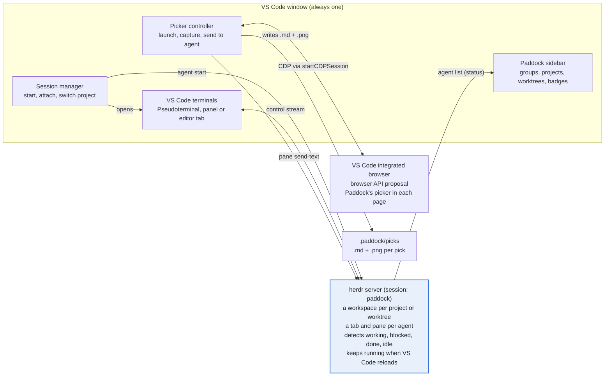

# Paddock Implementation Plan

Oct 8, 2026 · @Iyan Saputra

Paddock ships in six milestones, roughly 8.5 working days, each ending in something I can use day to day. It implements the Paddock PRD with [herdr](https://herdr.dev/) holding the agent terminals behind a single VS Code window, and a Chromium element picker driven over CDP.

## Architecture



Everything that must survive a project switch lives in herdr: the agents, their terminals and their state. The extension only draws, reconnects and sends input.

## Tech stack and data model

### Stack

| Part | Choice | Why |
| --- | --- | --- |
| Extension | TypeScript, VS Code extension API, bundled with esbuild | Standard, fast builds |
| Agent runtime | herdr 0.9.3 or later, called through its CLI with `child_process.execFile` (JSON output) | Keeps agents alive, detects their state, manages worktrees |
| Terminal | VS Code `Pseudoterminal` fed by `herdr terminal session control` | Native scrolling and shortcuts, no prefix keys |
| Browser | VS Code's integrated browser through the `browser` API proposal, driven over the Chrome DevTools Protocol (CDP) from `BrowserTab.startCDPSession()`, with an Orca-style picker injected into each page | A real browser inside VS Code; inspect overlay, HTML, styles and screenshots out of the box; no browser to ship |
| Storage | `globalState` for projects and groups, `workspaceState` for terminal layout | No database needed |

### Data model

- **Project:** `{ id, name, path, groupId, order, workspaceId }`, stored in `globalState`. `workspaceId` is the herdr workspace for the project's main checkout.
- **Session:** `{ paneId, agentName, projectId, worktreePath, kind, label, location }`, where `location` is `panel` or `editor`. The live list and each agent's state come from `herdr pane list` and `herdr agent list`; Paddock only stores labels and layout.
- **Pick:** `.paddock/picks/<timestamp>.md` (URL, selector, size, styles, HTML, comment) plus `<timestamp>.png`.

A **Group** is `{ id, name, order, collapsed }`, also in `globalState`. Each project points at one group; new projects land outside any group, at the top level of the tree, until I move them. Internally that is a hidden Ungrouped group that always exists; the tree never shows it as a header.

### How Paddock maps onto herdr

- **Session.** Paddock uses its own herdr session, `paddock` (`HERDR_SESSION=paddock` on every call), so its agents stay apart from herdr's default session. It's a setting, and the PRD lists the choice as an open question.
- **Project → workspace.** One herdr workspace per project, created with `herdr workspace create --cwd <path> --label <name> --no-focus`. A worktree is the workspace `herdr worktree create` makes, grouped with its repo.
- **Agent → tab.** Each agent gets its own herdr tab, whose root pane runs it, and a herdr name such as `nodus-1` (names must match `[a-z][a-z0-9_-]{0,31}`).
- **IDs.** Pane and workspace IDs always come from herdr's JSON responses, never predicted. After a `pane move`, Paddock switches to the new pane ID.

## Milestones

Build in this order; M1 alone already replaces Orca's project switching.

| Milestone | Delivers | PRD | Size (days) |
| --- | --- | --- | --- |
| M0 Scaffold | Extension runs, Paddock view in the activity bar, add and remove projects, groups with drag-and-drop ordering | R1 | 1 |
| M1 Sessions | herdr check, a workspace per project, start agents, VS Code terminals streamed from herdr panes, switch project in the same window, reattach after reload | R3, R4, R7–R11 | 2 |
| M2 Status | Badges from herdr's agent detection, waiting counts, notifications | R5, R6 | 0.5 |
| M3 Worktrees | List, create and remove worktrees through herdr | R2 | 0.5 |
| M4 Picker | Integrated browser, pick mode, capture, comment, copy or send to the agent | R12–R18 | 3.5 |
| M5 Polish | Settings, herdr version check and installer prompt, README, packaged `.vsix` | All | 1 |
| **Total** |  |  | **8.5** |

## Implementation details

### M0 Scaffold, groups and ordering

- **Sidebar is a webview view.** `paddock.projects` is a `WebviewView` (`src/tree/view.ts`), not a `TreeView`, so it can draw Orca-style rows: pill badges, a `primary` chip, a card around the open checkout and agent icons. `src/tree/model.ts` builds the rows as plain data (pure, unit-tested) and validates every message from the webview; `src/webview/sidebar.ts` draws them and is bundled separately to `dist/sidebar.js`. Right-click menus are native, contributed under `webview/context` with `webviewSection` set per row through `data-vscode-context`; hover buttons cover the old inline actions. The webview implements tree keyboard navigation itself (arrows, Home/End, Enter, Shift+F10). Multi-select is gone.
- **Drop rules.** A project dropped on the top half of a project goes before it, on the bottom half after it, in that project's group; a project dropped on a group goes to the end of that group; a project dropped below the list goes to the top level; a group dropped on a group goes before or after it.
- **Persist.** Drops rewrite `order` in `globalState` through `moveProjects` and `moveGroups`. Collapsing a group saves `collapsed`; project and session-list expansion is per-view state in the webview.
- **Keyboard path.** Context menu commands New group, Rename group, Delete group (projects move to the top level), Move to group (with a No group choice) a `+` on each group that adds a project straight into it, and the Add project and New group title-bar buttons (and an empty-state with both), since drag and drop has no keyboard equivalent.
- **Group badge.** A group's `description` shows its waiting count, read from the same status data as session badges.

### M1 Sessions

- **herdr check.** On activation run `herdr --version`; if it's missing or older than 0.9.3, offer the installer in a terminal. If `herdr status server` finds no server for the `paddock` session, start `herdr server` in the background.
- **Workspace.** The first time a project opens, run `herdr workspace create --cwd <path> --label <name> --no-focus` and store `workspaceId`.
- **Start.** `herdr tab create --workspace <id> --cwd <path> --no-focus` returns a root pane; then `herdr agent start <name> --kind claude --pane <paneId>`. A shell session stops after `tab create`. `agent start` answers `agent_not_ready` when the agent launched but is already blocked on a prompt (for example a trust dialog); the agent exists, so Paddock treats that as success. The first session of a new workspace reuses the root pane `workspace create` returns instead of opening a second tab. When the last pane of a workspace closes, herdr closes the workspace, so Paddock re-creates it on the next session.
- **Stream into VS Code.** Each terminal is a `Pseudoterminal`. It spawns `herdr terminal session control <paneId> --takeover --cols C --rows R` and reads newline-delimited JSON: `terminal.frame` carries base64 ANSI bytes for the write emitter, and `terminal.closed` closes the tab. Typed input, resizes and scrolling go back on stdin as `terminal.input` (`{text}` or base64 `{bytes}`), `terminal.resize` (`{cols, rows}`) and `terminal.scroll` (`{direction: up|down, lines}`); `terminal.release` detaches. These shapes are **not** in `herdr api schema --json` (that file covers the socket API only); they come from herdr's CLI reference and were confirmed against 0.9.3 by `test/integration/herdr.test.ts`.
- **Detach, not kill.** Closing the tab sends `terminal.release`; the agent keeps running. Killing is an explicit sidebar action (`herdr pane close`).
- **Switch project, `reload` mode (default).** Run `vscode.openFolder` with `forceNewWindow: false`. Terminal layout is saved per project in `workspaceState` as it changes.
- **Switch project, `swap` mode (`paddock.switchMode`).** VS Code restarts extensions when the first workspace folder changes or when a window becomes multi-root, so the first switch writes `Paddock.code-workspace` (in the extension's global storage, so VS Code does not ask to save an untitled workspace) with a fixed placeholder folder first and the project second, and opens it once. Later switches call `updateWorkspaceFolders(1, …)`, which does not restart the extension host. Because a multi-root window shares one editor state and one `workspaceState`, layouts and open files are stored per project id. On switching away Paddock saves the open file tabs (order, active tab, selection), stashes unsaved edits in the snapshot (nothing is written to disk), reverts and closes the tabs, then reopens the target project's files and re-applies its unsaved edits. If the file changed on disk meanwhile, the stashed edits open in an untitled editor instead of overwriting.
- **Reattach on activate.** Match the open folder to a project, list its panes with `herdr pane list --workspace <id>`, and reopen each saved session (matched by pane id and terminal id) where it was. Clicking a session of another project stores a pending-open request in `globalState`, switches project, and opens it after the reload.
- **Known gap.** VS Code's own terminal scrollback does not apply to herdr's repainted frames, so wheel scrolling through history is not wired up yet; `terminal.scroll` exists for it. Check this in manual testing.

### M2 Status

- **Source.** Poll `herdr agent list` every 1 to 2 s. Switch to a socket subscription if the installed herdr's API schema offers one.
- **Mapping.** `working` and `unknown` show as running, `blocked` as waiting, `done` and `idle` as done. A pane with no agent shows as running or exited.
- **Integrations.** With my approval, `herdr integration install claude` and `codex` give exact state instead of screen detection.
- **Updates.** A state change fires the tree's `onDidChangeTreeData`. A change to blocked shows a notification with "Go to session"; opening it runs `herdr agent focus`, which marks the completion as seen.

### M3 Worktrees

- **List** with `herdr worktree list --cwd <project path>`. `--cwd` instead of `--workspace` works before the project has a herdr workspace, so listing never creates one (and its stray shell). The list includes the main checkout (`is_linked_worktree: false`); a folder that is not a git repository answers `not_git_worktree` and shows its sessions directly, without worktree rows. The last list per project is kept in `globalState`, so a window opened on a worktree knows its project before herdr answers. Paddock re-lists on activation, on window focus, after adding a project, and when `workspace list` shows a workspace on a checkout it does not know.
- **Tree.** A git project expands to its checkouts (main first, labelled by branch), each expanding to its sessions. A worktree's workspace is matched by `worktree.checkout_path` in `workspace list`, since herdr labels it with the branch, not the project name. Layouts and open files are keyed per checkout (the main checkout keeps the project id).
- **Create** with `herdr worktree create --cwd <project path> --branch <name> --no-focus`. An existing branch is checked out, any other name becomes a new branch. herdr makes the checkout under `~/.herdr/worktrees/<repo>/<branch>` and returns the new workspace with a root shell pane; the first session started there takes over that pane.
- **Reopen.** herdr closes a worktree's workspace with its last pane (the checkout stays, `open_workspace_id` disappears). Starting a session there runs `herdr worktree open --cwd <project path> --path <checkout> --no-focus` first.
- **Remove** with `herdr worktree remove --workspace <id>`, which needs an open workspace, so Paddock reopens it first if needed. It also closes the workspace and its sessions. A dirty checkout answers `dirty_worktree_requires_force`; `--force` is added only after I confirm. It never deletes the branch. The main checkout answers `not_linked_worktree` and has no Remove action. Removing the worktree open in the current window first switches to the project's own folder; in `reload` mode the request is stored in `globalState` (valid for a minute) and finished after the reload.
- **Errors.** herdr 0.9.3 writes error envelopes (`{"error":{"code",…}}`) to stderr with a non-zero exit, not to stdout; `cli.ts` reads them from there.

### M4 Picker

- **Browser API.** Paddock uses VS Code's `browser` API proposal (`src/vscode.proposed.browser.d.ts`, `enabledApiProposals: ["browser"]`): `window.openBrowserTab`, `window.browserTabs`, `onDidOpenBrowserTab` / `onDidCloseBrowserTab`, `activeBrowserTab`, and `BrowserTab.startCDPSession()`. No debugger is involved: no debug toolbar, no Debug Console, no tab prompt. Stable VS Code allows a proposal only for an extension started with `--enable-proposed-api=undefined_publisher.paddock` (already in `.vscode/launch.json` and `.vscode-test.mjs`); an installed `.vsix` needs `"enable-proposed-api": ["undefined_publisher.paddock"]` in `argv.json` and a full restart. Without it, Open Browser explains this and offers to open `argv.json`. The Marketplace does not take extensions that use proposals, and the proposal can change between VS Code releases. Earlier versions used `editor-browser` debug sessions through js-debug's CDP proxy (a launched session, then one attached per pick); both showed the debug toolbar, and the launched one raced js-debug's `about:blank` → URL navigation.
- **Open.** **Paddock: Open Browser** (the globe in the sidebar title) runs `window.openBrowserTab('', { viewColumn: Active })`: an empty tab in the current editor group, next to the other tabs, and I type the URL. There is no URL setting.
- **CDP.** `startCDPSession()` is a browser-level session. `Target.setAutoAttach({ flatten: true })` attaches the page, and commands go to its `sessionId`. `src/picker/cdp.ts` is a small client over that message channel; there is no browser library. `src/picker/browser.ts` attaches to every integrated browser tab, open or opened later, and keeps one `PagePicker` (`src/picker/page-picker.ts`) per page.
- **Picker in the page (Orca's grab mode).** `src/picker/page.ts` is injected with `Page.addScriptToEvaluateOnNewDocument` and once with `Runtime.evaluate`, inside a closed shadow root, and talks back through `Runtime.addBinding` (`Runtime.bindingCalled`). The page can call that binding too, so every message is validated (`src/picker/protocol.ts`). A Pick button sits in the bottom-right corner; **Paddock: Pick Element in Browser** (Cmd+Alt+P / Ctrl+Alt+P) toggles it in the active tab. Pick mode lays a full-page click catcher over the page: on mouse move it finds the element underneath with `elementFromPoint` (the catcher briefly stops taking pointer events) and draws its own white box and a dark label (`h2  role=…  "text"  524x144`). The click lands on the catcher, so the page never sees it. C copies the hovered element without the card; Esc cancels. Nothing here depends on DevTools' inspect overlay.
- **Capture.** The page reads the element itself: selector (the shortest unique `tag.class.class` chain, with `:nth-of-type` where siblings match), role (ARIA or tag), text, nearby text (sibling and parent text, at most three lines), ancestor and full DOM paths, outer HTML, `getComputedStyle` for the properties `filterStyles` knows, and the box in document coordinates. It hides itself and waits briefly (a timer, since animation frames stop in a hidden tab) before reporting, so `Page.captureScreenshot` clipped to the box with `captureBeyondViewport` shows neither the highlight nor the card. A tab that is not on screen never answers the screenshot, so it times out after 4 s and the pick goes on without one. The extension trims the HTML to about 2 KB and keeps only non-default layout, spacing, typography and colour values (equal sides folded into `margin`, `padding` and so on).
- **React component.** The page reads the node's `__reactFiber$…` key and walks `.return` to the nearest function or class component with a real name, skipping framework internals such as names starting with `__`. Production builds may show minified names.
- **Card.** After a click, a card next to the element shows the selector, size, text and screenshot thumbnail, an instruction box, Cancel, Copy and Send to <session>. Enter sends, Cmd/Ctrl+Enter copies. Copy goes straight back to pick mode for the next element (as in Orca); Send ends it and focuses the agent's terminal. Failures (no session to send to) show on the page and keep the card open.
- **Format.** Build one plain-text block in the layout below and write it to `.paddock/picks/<timestamp>.md`, next to `<timestamp>.png`. The timestamp is `YYYYMMDD-HHMMSS-<tag>`, with `-2`, `-3` added rather than overwriting. Copy writes the files too, since the text names the screenshot.
- **Copy.** Put the block (plus the instruction, if any) on the clipboard with `vscode.env.clipboard.writeText`.
- **Send.** Run `herdr pane send-text <paneId> " @<relPath> "` (leading space as in PRD R16, so it does not run into text already typed), which types without pressing Enter, and focus that session's VS Code terminal. The path is relative to the agent's checkout. The target is the last focused Paddock terminal, tracked with `window.onDidChangeActiveTerminal`; before any is focused, an agent in this window's checkout (one with an open terminal first). The instruction is saved in the `.md`, not typed.
- **Git.** Append `.paddock/` to the exclude file once, found with `git rev-parse --git-path info/exclude` so linked worktrees use the main repository's.

Pick format, shown with the yapp.ink hero heading:

```text
Attached browser context from https://yapp.ink/

Selected element:
h2
Role: h2
Selector: section.flex.h-svh > h2.max-w-\[524px\].text-3xl
React: <Hero>
Dimensions: 524x144
Screenshot: .paddock/picks/20261008-1410-h2.png

Text content:
Your All In One Creator Platform

Nearby context:
- 1000+ Creators already Joined us
- Links, digital products, tipping, campaigns, and livestream overlays, ...
- Start Exploring Become a Creator

Computed styles:
  display: block
  font-size: 60px
  color: lab(14.6704 0 0)

HTML:
<h2 class="max-w-[524px] text-3xl md:text-5xl lg:text-6xl ...">Your All In One Creator Platform</h2>

Ancestor path: section > div > body
Full DOM path: body > div > section.flex.h-svh > h2.max-w-\[524px\].text-3xl

Instruction: make this heading smaller on mobile
```

### M5 Polish

- Settings: `paddock.agents` (name and herdr kind presets), `paddock.herdrSession`, `paddock.terminalLocation`.
- Decide the publisher id before packaging: the extension id is `undefined_publisher.paddock` today, `argv.json` names it for the browser API, and changing it moves `globalState` (projects and groups) to a new key.
- On activation, check herdr's version and `herdr api schema`, and offer `curl -fsSL https://herdr.dev/install.sh | sh` when herdr is missing.
- README with a short GIF of switching and picking.

## Testing and release

- **Unit tests** (Vitest) for the parts with no VS Code dependency: parsing herdr's JSON responses, decoding `terminal.frame` records, state mapping, style filtering.
- **Integration tests** with `@vscode/test-electron`: activation, adding a project, starting and reattaching a session against a real herdr server on a throwaway session name.
- **Manual checklist per milestone**, run on my own projects:
  - [ ] Switch between nodus-studio and d1-studio while Claude Code is mid-task; the session is intact after the reload
  - [ ] Quit VS Code, reopen; every session reattaches in its old place
  - [ ] A session waiting for input shows the badge and a notification within 2 s
  - [ ] Pick a header element on localhost; the `@` reference appears in the prompt without being sent
- **Release.** Package with `vsce package` and install the `.vsix` locally. Publishing to the Marketplace and Open VSX waits until I've used it daily for a week.