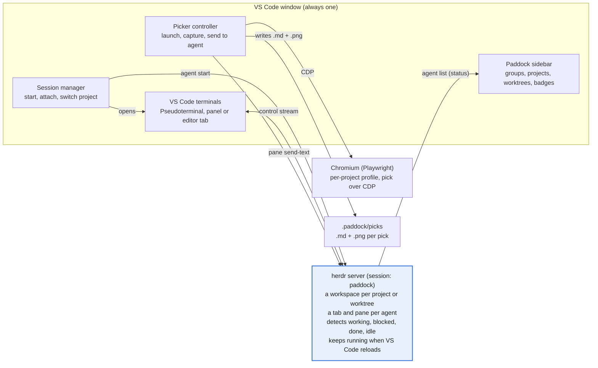

# Paddock Implementation Plan

Oct 8, 2026 · @Iyan Saputra

Paddock ships in six milestones, roughly 8.5 working days, each ending in something I can use day to day. It implements the Paddock PRD with [herdr](https://herdr.dev/) holding the agent terminals behind a single VS Code window, and a Chromium element picker driven over CDP.

## Architecture



Everything that must survive a project switch lives in herdr: the agents, their terminals and their state. The extension only draws, reconnects and sends input.

## Tech stack and data model

### Stack

| Part | Choice | Why |
| --- | --- | --- |
| Extension | TypeScript, VS Code extension API, bundled with esbuild | Standard, fast builds |
| Agent runtime | herdr 0.9.3 or later, called through its CLI with `child_process.execFile` (JSON output) | Keeps agents alive, detects their state, manages worktrees |
| Terminal | VS Code `Pseudoterminal` fed by `herdr terminal session control` | Native scrolling and shortcuts, no prefix keys |
| Browser | `playwright-core` over the Chrome DevTools Protocol (CDP), installed Chrome first | Inspect overlay, HTML, styles and screenshots out of the box |
| Storage | `globalState` for projects and groups, `workspaceState` for terminal layout | No database needed |

### Data model

- **Project:** `{ id, name, path, groupId, order, workspaceId }`, stored in `globalState`. `workspaceId` is the herdr workspace for the project's main checkout.
- **Session:** `{ paneId, agentName, projectId, worktreePath, kind, label, location }`, where `location` is `panel` or `editor`. The live list and each agent's state come from `herdr pane list` and `herdr agent list`; Paddock only stores labels and layout.
- **Pick:** `.paddock/picks/<timestamp>.md` (URL, selector, size, styles, HTML, comment) plus `<timestamp>.png`.

A **Group** is `{ id, name, order, collapsed }`, also in `globalState`. Each project points at one group; new projects land outside any group, at the top level of the tree, until I move them. Internally that is a hidden Ungrouped group that always exists; the tree never shows it as a header.

### How Paddock maps onto herdr

- **Session.** Paddock uses its own herdr session, `paddock` (`HERDR_SESSION=paddock` on every call), so its agents stay apart from herdr's default session. It's a setting, and the PRD lists the choice as an open question.
- **Project → workspace.** One herdr workspace per project, created with `herdr workspace create --cwd <path> --label <name> --no-focus`. A worktree is the workspace `herdr worktree create` makes, grouped with its repo.
- **Agent → tab.** Each agent gets its own herdr tab, whose root pane runs it, and a herdr name such as `nodus-1` (names must match `[a-z][a-z0-9_-]{0,31}`).
- **IDs.** Pane and workspace IDs always come from herdr's JSON responses, never predicted. After a `pane move`, Paddock switches to the new pane ID.

## Milestones

Build in this order; M1 alone already replaces Orca's project switching.

| Milestone | Delivers | PRD | Size (days) |
| --- | --- | --- | --- |
| M0 Scaffold | Extension runs, Paddock view in the activity bar, add and remove projects, groups with drag-and-drop ordering | R1 | 1 |
| M1 Sessions | herdr check, a workspace per project, start agents, VS Code terminals streamed from herdr panes, switch project in the same window, reattach after reload | R3, R4, R7–R11 | 2 |
| M2 Status | Badges from herdr's agent detection, waiting counts, notifications | R5, R6 | 0.5 |
| M3 Worktrees | List, create and remove worktrees through herdr | R2 | 0.5 |
| M4 Picker | Chromium window, pick mode, capture, comment, copy or send to the agent | R12–R17 | 3.5 |
| M5 Polish | Settings, herdr version check and installer prompt, README, packaged `.vsix` | All | 1 |
| **Total** |  |  | **8.5** |

## Implementation details

### M0 Scaffold, groups and ordering

- **Tree with drag and drop.** `window.createTreeView('paddock.projects', { treeDataProvider, dragAndDropController, canSelectMany: true })`. The controller declares the mime type `application/vnd.code.tree.paddock.projects` for both drag and drop.
- **Drop rules.** VS Code trees drop onto an item, not into a gap, so: a project dropped on a project goes before it, in that project's group (or among the top-level projects); a project dropped on a group goes to the end of that group; a project dropped on empty space goes to the top level; a group dropped on a group goes before it.
- **Persist.** `handleDrop` rewrites `order` for the affected group (or for all groups) in `globalState`, then fires `onDidChangeTreeData`. `onDidCollapseElement` and `onDidExpandElement` save `collapsed`.
- **Keyboard path.** Context menu commands New group, Rename group, Delete group (projects move to the top level), Move to group (with a No group choice) a `+` on each group that adds a project straight into it, and an always-visible "Add project" row at the bottom of the tree for the top level, since tree drag and drop has no keyboard equivalent.
- **Group badge.** A group's `description` shows its waiting count, read from the same status data as session badges.

### M1 Sessions

- **herdr check.** On activation run `herdr --version`; if it's missing or older than 0.9.3, offer the installer in a terminal. If `herdr status server` finds no server for the `paddock` session, start `herdr server` in the background.
- **Workspace.** The first time a project opens, run `herdr workspace create --cwd <path> --label <name> --no-focus` and store `workspaceId`.
- **Start.** `herdr tab create --workspace <id> --cwd <path> --no-focus` returns a root pane; then `herdr agent start <name> --kind claude --pane <paneId>`. A shell session stops after `tab create`. `agent start` answers `agent_not_ready` when the agent launched but is already blocked on a prompt (for example a trust dialog); the agent exists, so Paddock treats that as success. The first session of a new workspace reuses the root pane `workspace create` returns instead of opening a second tab. When the last pane of a workspace closes, herdr closes the workspace, so Paddock re-creates it on the next session.
- **Stream into VS Code.** Each terminal is a `Pseudoterminal`. It spawns `herdr terminal session control <paneId> --takeover --cols C --rows R` and reads newline-delimited JSON: `terminal.frame` carries base64 ANSI bytes for the write emitter, and `terminal.closed` closes the tab. Typed input, resizes and scrolling go back on stdin as `terminal.input` (`{text}` or base64 `{bytes}`), `terminal.resize` (`{cols, rows}`) and `terminal.scroll` (`{direction: up|down, lines}`); `terminal.release` detaches. These shapes are **not** in `herdr api schema --json` (that file covers the socket API only); they come from herdr's CLI reference and were confirmed against 0.9.3 by `test/integration/herdr.test.ts`.
- **Detach, not kill.** Closing the tab sends `terminal.release`; the agent keeps running. Killing is an explicit sidebar action (`herdr pane close`).
- **Switch project.** Save the layout to `workspaceState`, then run `vscode.openFolder` with `forceNewWindow: false`.
- **Reattach on activate.** Match the open folder to a project, list its panes with `herdr pane list --workspace <id>`, and reopen each saved session (matched by pane id and terminal id) where it was. Clicking a session of another project stores a pending-open request in `globalState`, switches project, and opens it after the reload.
- **Known gap.** VS Code's own terminal scrollback does not apply to herdr's repainted frames, so wheel scrolling through history is not wired up yet; `terminal.scroll` exists for it. Check this in manual testing.

### M2 Status

- **Source.** Poll `herdr agent list` every 1 to 2 s. Switch to a socket subscription if the installed herdr's API schema offers one.
- **Mapping.** `working` and `unknown` show as running, `blocked` as waiting, `done` and `idle` as done. A pane with no agent shows as running or exited.
- **Integrations.** With my approval, `herdr integration install claude` and `codex` give exact state instead of screen detection.
- **Updates.** A state change fires the tree's `onDidChangeTreeData`. A change to blocked shows a notification with "Go to session"; opening it runs `herdr agent focus`, which marks the completion as seen.

### M3 Worktrees

- List with `herdr worktree list --workspace <id>`.
- Create with `herdr worktree create --workspace <id> --branch <name> --no-focus`. herdr makes the checkout under its worktrees directory and returns the new workspace.
- Remove with `herdr worktree remove --workspace <id>`, adding `--force` only after I confirm a dirty checkout. It never deletes the branch.

### M4 Picker

- **Launch.** `chromium.launchPersistentContext(<per-project profile>, { headless: false, channel: 'chrome' })`, falling back to bundled Chromium. The per-project profile keeps logins between runs.
- **Toolbar.** `context.addInitScript` injects a small floating bar (Pick, comment box, Copy, Send) into every page. It talks to the extension through `context.exposeBinding`.
- **Pick mode.** Open a CDP session and call `Overlay.setInspectMode` with `searchForNode` and `highlightConfig.showInfo: true`, which draws DevTools' tag-and-size label. The click arrives as `Overlay.inspectNodeRequested` with a `backendNodeId`.
- **Capture from CDP.** `DOM.getOuterHTML` (trimmed to about 2 KB), `CSS.getComputedStyleForNode` filtered to non-default layout, spacing, typography and colour values, `DOM.getBoxModel`, and `Page.captureScreenshot` clipped to the box.
- **Capture from the page.** One `Runtime.callFunctionOn` on the node returns the selector, role (ARIA or tag), text content, nearby text (sibling and parent text, at most three lines), the ancestor path and the full DOM path.
- **React component.** The same call reads the node's `__reactFiber$…` key and walks `.return` to the nearest function or class component with a real name, skipping framework internals such as names starting with `__`. Production builds may show minified names.
- **Format.** Build one plain-text block in the layout below and write it to `.paddock/picks/<timestamp>.md`, next to `<timestamp>.png`.
- **Copy.** Put the block (plus the instruction, if any) on the clipboard with `vscode.env.clipboard.writeText`.
- **Send.** Run `herdr pane send-text <paneId> "@<relPath> "`, which types without pressing Enter, and focus that session's VS Code terminal. The target is the last focused Paddock terminal, tracked with `window.onDidChangeActiveTerminal`.
- **Git.** Append `.paddock/` to `.git/info/exclude` once.

Pick format, shown with the yapp.ink hero heading:

```text
Attached browser context from https://yapp.ink/

Selected element:
h2
Role: h2
Selector: section.flex.h-svh > h2.max-w-\[524px\].text-3xl
React: <Hero>
Dimensions: 524x144
Screenshot: .paddock/picks/20261008-1410-h2.png

Text content:
Your All In One Creator Platform

Nearby context:
- 1000+ Creators already Joined us
- Links, digital products, tipping, campaigns, and livestream overlays, ...
- Start Exploring Become a Creator

Computed styles:
  display: block
  font-size: 60px
  color: lab(14.6704 0 0)

HTML:
<h2 class="max-w-[524px] text-3xl md:text-5xl lg:text-6xl ...">Your All In One Creator Platform</h2>

Ancestor path: section > div > body
Full DOM path: body > div > section.flex.h-svh > h2.max-w-\[524px\].text-3xl

Instruction: make this heading smaller on mobile
```

### M5 Polish

- Settings: `paddock.agents` (name and herdr kind presets), `paddock.herdrSession`, `paddock.terminalLocation`, `paddock.browser.defaultUrl`.
- On activation, check herdr's version and `herdr api schema`, and offer `curl -fsSL https://herdr.dev/install.sh | sh` when herdr is missing.
- README with a short GIF of switching and picking.

## Testing and release

- **Unit tests** (Vitest) for the parts with no VS Code dependency: parsing herdr's JSON responses, decoding `terminal.frame` records, state mapping, style filtering.
- **Integration tests** with `@vscode/test-electron`: activation, adding a project, starting and reattaching a session against a real herdr server on a throwaway session name.
- **Manual checklist per milestone**, run on my own projects:
  - [ ] Switch between nodus-studio and d1-studio while Claude Code is mid-task; the session is intact after the reload
  - [ ] Quit VS Code, reopen; every session reattaches in its old place
  - [ ] A session waiting for input shows the badge and a notification within 2 s
  - [ ] Pick a header element on localhost; the `@` reference appears in the prompt without being sent
- **Release.** Package with `vsce package` and install the `.vsix` locally. Publishing to the Marketplace and Open VSX waits until I've used it daily for a week.